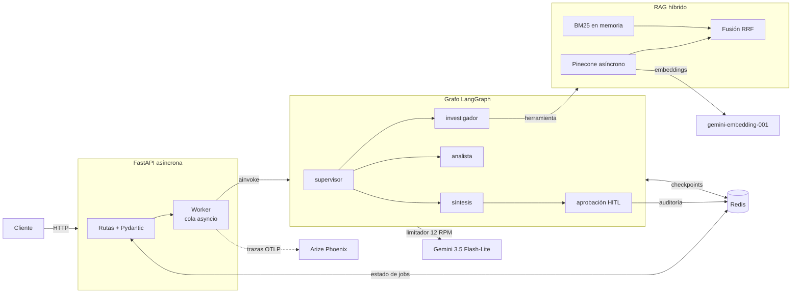
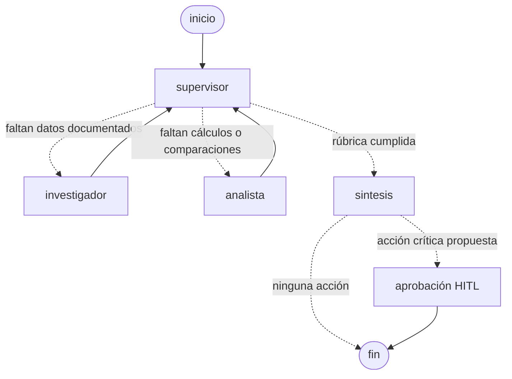
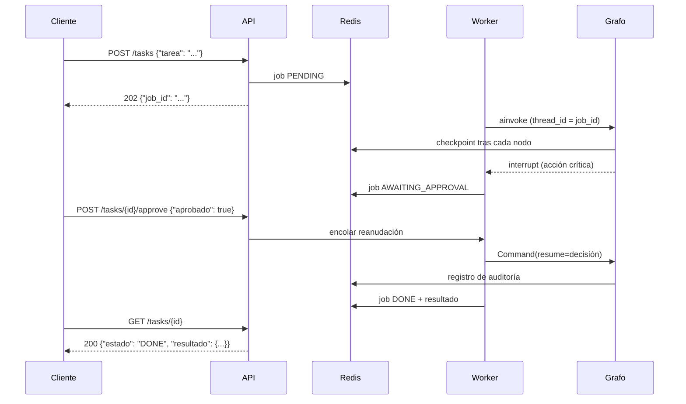

# Entrega final: Kestrel Intelligence System

Sistema de IA de grado de producción que responde preguntas operativas sobre **Kestrel**, la plataforma ficticia de la empresa Nubaria. Integra en un solo flujo las capas construidas durante el curso:

- **RAG híbrido:** búsqueda semántica en Pinecone combinada con BM25 mediante Reciprocal Rank Fusion.
- **Agentes con supervisor:** un supervisor delega en un investigador (documentación) y un analista (cálculos), valida el trabajo con una rúbrica y decide cuándo terminar.
- **Aprobación humana (HITL):** las acciones con efectos secundarios, como revertir un despliegue, se pausan hasta que una persona las aprueba.
- **API profesional:** FastAPI asíncrona, validada con Pydantic y documentada en `/docs`.
- **Persistencia y trazabilidad:** checkpoints de LangGraph en Redis, recuperación automática tras un reinicio y trazas completas en Arize Phoenix.

## Inicio rápido (un solo comando)

Requisitos: Docker, las claves de Gemini y Pinecone y el índice de Pinecone con la documentación (ver [Configuración](#configuración)).

```bash
cd entrega-final
./run.sh
```

`run.sh` crea `.env` desde `.env.example` si no existe, comprueba que las claves estén disponibles, construye la imagen, levanta **API + Redis + Phoenix** con Docker Compose y espera a que la API responda. Equivale a:

```bash
cp .env.example .env
docker compose up --build -d
```

| Servicio | Dirección |
|---|---|
| API y documentación interactiva | http://localhost:8000/docs |
| Trazas en Arize Phoenix | http://localhost:6006 |

En GitHub Codespaces, ambas direcciones se abren desde la pestaña **PORTS**. Para detener todo: `./run.sh stop`.

## Arquitectura



Cada capa vive en su propio paquete y viene de una etapa del curso:

| Capa | Módulo | Responsabilidad | Origen |
|---|---|---|---|
| Configuración | `app/settings.py` | Variables de entorno validadas con `pydantic-settings` | PE2 a PE7 |
| Modelos | `app/llm.py` | LLM de chat con limitador compartido y embeddings | PE1, PE2 y PE7 |
| RAG | `app/rag/` | Fragmentación, Pinecone asíncrono, BM25 y fusión RRF | PE3 y PE4 |
| Agentes | `app/agents/` | Supervisor, investigador y analista con herramientas validadas | PE5 y PE6 |
| Orquestación | `app/graph/` | Estado, grafo, síntesis estructurada y nodo HITL | PE6 y PE7 |
| Servicios | `app/services/` | Repositorio de jobs en Redis y worker con recuperación tras reinicios | PE7 |
| API | `app/api/` | Rutas y esquemas de entrada y salida | PE7 |
| Observabilidad | `app/observability.py` | Instrumentación de LangChain y spans de jobs hacia Phoenix | PE7 |

`app/main.py` arma todas las capas al arrancar (lifespan) y las cierra al apagar.

## Grafo de agentes

Diagrama generado desde el código con `python scripts/exportar_grafo.py` (fuente en [`docs/grafo.mmd`](docs/grafo.mmd)). Las líneas punteadas son decisiones condicionales.



| Nodo | Qué hace | Salida validada |
|---|---|---|
| `supervisor` | Aplica una rúbrica de 4 criterios (datos documentados, cálculos verificados, coherencia y cobertura) y elige el siguiente nodo. Una regla determinista impide terminar sin el aporte de ambos especialistas. Máximo 6 pasos | `DecisionSupervisor` |
| `investigador` | Agente ReAct con la herramienta `buscar_documentacion` (RAG híbrido). Devuelve datos exactos con su fuente, por ejemplo `[despliegues-00]` | `BuscarDocumentacionArgs` y `ResultadoBusqueda` |
| `analista` | Agente ReAct con `calcular`, `analizar_disponibilidad` y `comparar_con_umbral`. Nunca calcula mentalmente | Un modelo de entrada y uno de salida por herramienta |
| `sintesis` | Redacta la respuesta final con citas y propone una `accion_critica` | `SintesisFinal` |
| `aprobacion` | Pausa el grafo con `interrupt()` hasta recibir la decisión humana. Si se aprueba, ejecuta la acción (simulada) y deja un registro de auditoría en Redis | `SolicitudAprobacion` y `DecisionHumana` |

Cada especialista recibe solo la instrucción del supervisor (y el analista, los datos del investigador), nunca el historial completo. Así se evita que un agente se contamine con contexto que no necesita.

## Flujo de una tarea



## API

| Método y ruta | Qué hace | Respuestas |
|---|---|---|
| `GET /health` | Estado de la API, de Redis y tamaño de la cola | `200` |
| `POST /tasks` | Crea un job. Cuerpo: `{"tarea": "...", "simular_error": false}` | `202`, `422` |
| `GET /tasks/{job_id}` | Estado y resultado del job | `200`, `404`, `422` |
| `POST /tasks/{job_id}/approve` | Aprueba o rechaza la acción crítica. Cuerpo: `{"aprobado": true, "comentario": "..."}` | `202`, `404`, `409`, `422` |
| `GET /tasks/{job_id}/checkpoint` | Último checkpoint de LangGraph guardado en Redis | `200`, `404`, `422` |

Estados de un job: `PENDING` → `RUNNING` → `DONE`, o `RUNNING` → `AWAITING_APPROVAL` → (aprobación) → `PENDING` → `RUNNING` → `DONE`. Cualquier error deja el job en `FAILED` con el mensaje en `error`.

**Ejemplo:**

```bash
JOB=$(curl -s -X POST http://localhost:8000/tasks -H "Content-Type: application/json" \
  -d '{"tarea": "Durante un despliegue canario la tasa de errores llegó al 2,4 % durante 6 minutos consecutivos. ¿Qué exige la documentación?"}' \
  | python3 -c "import sys, json; print(json.load(sys.stdin)['job_id'])")
curl -s http://localhost:8000/tasks/$JOB                 # repetir hasta AWAITING_APPROVAL o DONE
curl -s -X POST http://localhost:8000/tasks/$JOB/approve -H "Content-Type: application/json" \
  -d '{"aprobado": true, "comentario": "Revisado"}'
curl -s http://localhost:8000/tasks/$JOB                 # DONE con la respuesta y el registro de auditoría
```

## Asincronía y validación

Toda la comunicación con servicios externos es asíncrona (`async`/`await`), sin llamadas bloqueantes dentro de funciones `async def`:

| Servicio | Cliente asíncrono |
|---|---|
| LLM (Gemini) | `ChatGoogleGenerativeAI.ainvoke` con `InMemoryRateLimiter` |
| Embeddings | `OpenAIEmbeddings.aembed_query` (endpoint compatible con OpenAI de Gemini) |
| Pinecone | `PineconeAsyncio` e `IndexAsyncio.query`, con una sesión abierta durante toda la vida de la API |
| Redis | `redis.asyncio` y `AsyncRedisSaver` para los checkpoints |
| Grafo | `CompiledStateGraph.ainvoke` y `aget_state` |
| Scripts de prueba | `httpx.AsyncClient` |

BM25 es cálculo en memoria (milisegundos, sin red), así que se ejecuta directo. La única operación pesada de CPU, fragmentar la documentación al arrancar, corre en un hilo con `asyncio.to_thread`.

**Validación con Pydantic en cada frontera:**

- **Configuración:** `Settings` (`pydantic-settings`). Si falta una variable obligatoria, la API no arranca y el error dice cuál falta.
- **Entradas de la API:** `SolicitudTarea` y `DecisionHumana` (con `extra="forbid"`), y el `job_id` validado con un patrón. Una entrada inválida responde `422`.
- **Salidas de la API:** cada ruta declara `response_model`, así que lo que se responde es exactamente lo que documenta `/docs`.
- **Herramientas de los agentes:** cada herramienta declara `args_schema` y devuelve un modelo serializado. Si el LLM envía argumentos inválidos, el agente recibe el error de validación y puede corregirse.
- **Salidas de los LLM:** `with_structured_output` con `DecisionSupervisor` y `SintesisFinal`.
- **Estado del grafo:** contribuciones y decisiones se validan al crearse y se guardan como JSON.

## Persistencia

El grafo se compila con `AsyncRedisSaver`, que guarda un checkpoint después de cada nodo con `thread_id = job_id`. Redis usa `appendonly` y un volumen de Docker, así que los datos sobreviven también a un reinicio del contenedor de Redis.

Al arrancar, el worker revisa los jobs que quedaron en `PENDING` o `RUNNING` y los retoma:

| Situación al reiniciar | Qué hace `recuperar_pendientes()` |
|---|---|
| El job no llegó a empezar (sin checkpoint) | Lo vuelve a encolar desde el principio |
| El job estaba a mitad del grafo | Lo continúa desde el último checkpoint (`ainvoke(None)`), sin repetir los nodos terminados |
| El job esperaba aprobación | Lo deja en `AWAITING_APPROVAL`; la pausa sigue en Redis |
| Ya había llegado la aprobación, pero no se procesó | Reanuda el grafo con la decisión guardada |

El mismo mecanismo protege ante **errores transitorios del proveedor** (503 por sobrecarga, 429 por límite o timeouts). El job vuelve a `PENDING` y se reintenta desde su último checkpoint, con espera exponencial (20, 40 y 80 s), hasta `JOB_MAX_REINTENTOS` veces. No repite los nodos que ya terminaron, así que no gasta llamadas de más. Los campos `reintentos` y `ultimo_error` del job muestran lo ocurrido. Los errores permanentes van directo a `FAILED`.

`scripts/prueba_reinicio.py` lo demuestra con el sistema real: reinicia el contenedor de la API durante una pausa HITL y durante una ejecución, y comprueba que ambos jobs terminan en `DONE`.

## Observabilidad

`app/observability.py` registra un proveedor de OpenTelemetry hacia Phoenix e instrumenta LangChain/LangGraph con OpenInference. Cada ejecución del worker crea un span raíz `job.iniciar`, `job.reanudar` o `job.continuar` con:

- `input.value` (la tarea) y `output.value` (la respuesta), visibles en la tabla de trazas.
- `session.id = job_id`, para que Phoenix agrupe en **Sessions** todas las trazas de un mismo job.
- Dentro, un span por nodo del grafo, por llamada al LLM (con tokens) y por herramienta.

No se usa un proveedor global ni la instrumentación automática, porque FastAPI registraría cada consulta de estado (`GET /tasks/...`) y llenaría Phoenix de ruido. Este problema se detectó en la PE7. `scripts/metricas_phoenix.py` descarga las trazas y calcula la latencia p50/p95 y el costo estimado por ejecución.

## Pruebas

### Pruebas automáticas (sin claves ni red)

```bash
pip install -r requirements-dev.txt
python -m pytest -q
ruff check .
```

34 pruebas con dobles de prueba (nodos falsos, Redis y tracer falsos y checkpointer en memoria):

| Archivo | Qué comprueba |
|---|---|
| `tests/test_rag.py` | Tokenización, BM25 con filtro de categoría, fusión RRF (orden, pesos y duplicados) y recuperador híbrido |
| `tests/test_herramientas.py` | Herramientas del analista y del investigador: resultados correctos y rechazo de argumentos inválidos; regla determinista del supervisor |
| `tests/test_grafo.py` | Topología, pausa y reanudación HITL, rechazo sin efectos secundarios, camino sin acción crítica y retoma de un grafo nuevo con el mismo checkpointer |
| `tests/test_worker.py` | Ciclo completo con spans, estado `FAILED`, recuperación tras un reinicio (a mitad del grafo y con una aprobación pendiente), reintentos ante errores transitorios y clasificación de errores |
| `tests/test_api.py` | Códigos `202`, `404`, `409` y `422`, validación de cuerpos y del `job_id`, y documentación OpenAPI |

### Pruebas del sistema completo

Con el sistema levantado:

```bash
python scripts/load_test.py                    # 5 solicitudes concurrentes
python scripts/prueba_reinicio.py              # persistencia ante reinicios
python scripts/metricas_phoenix.py --minutos 120
```

Los resultados se guardan en `resultados/` y las capturas en `screenshots/`.

## Resultados

<!-- Se completa con los resultados reales de las pruebas del sistema. -->

## Configuración

Todas las variables están en `.env.example`. Las obligatorias no tienen valor por defecto en el código: si faltan, la API no arranca.

| Variable | Obligatoria | Descripción |
|---|---|---|
| `GEMINI_API_KEY` | Sí | Clave de Gemini, para el LLM y los embeddings. En Codespaces, como secret |
| `PINECONE_API_KEY` | Sí | Clave de Pinecone. En Codespaces, como secret |
| `LLM_MODEL` | Sí | Modelo de chat, por ejemplo `gemini-3.5-flash-lite` |
| `EMBEDDING_MODEL` | Sí | Modelo de embeddings con el que se indexó Pinecone |
| `PINECONE_INDEX` y `PINECONE_NAMESPACE` | Sí | Índice y namespace de la documentación |
| `EMBEDDING_BASE_URL` | No | Endpoint compatible con OpenAI (el de Gemini en `.env.example`) |
| `LLM_RPM` | No (12) | Máximo de llamadas por minuto al LLM |
| `RAG_TOP_K` y `RAG_PESO_VECTORIAL` | No (4 y 0,5) | Fragmentos por búsqueda y peso de la búsqueda semántica en la fusión |
| `WORKER_CONCURRENCY` | No (2) | Jobs procesados en paralelo |
| `JOB_MAX_REINTENTOS` y `JOB_ESPERA_REINTENTO_S` | No (3 y 20) | Reintentos ante errores transitorios y espera base, que se duplica en cada intento |
| `REDIS_URL`, `PHOENIX_ENDPOINT` y `PHOENIX_PROJECT` | No | Conexiones. Docker Compose las ajusta a los nombres de sus servicios |

**Índice de Pinecone:** el sistema usa el índice `kestrel-hybrid-rag` creado en la PE4. En una instalación nueva, créalo y carga la documentación con:

```bash
pip install -r requirements-dev.txt
python scripts/ingestar.py
```

## Estructura del repositorio

```
entrega-final/
├── app/
│   ├── main.py             # arranque y cierre de todas las capas (lifespan)
│   ├── settings.py         # configuración validada
│   ├── llm.py              # LLM con limitador y embeddings
│   ├── observability.py    # Phoenix
│   ├── rag/                # documentos, vectorial, léxico, híbrido y modelos
│   ├── agents/             # supervisor, investigador, analista y lógica común
│   ├── graph/              # estado, builder, síntesis y HITL
│   ├── services/           # jobs en Redis y worker
│   └── api/                # rutas y esquemas
├── data/                   # documentación de Kestrel (8 archivos) y catálogo de categorías
├── scripts/                # load_test, prueba_reinicio, metricas_phoenix, ingestar y exportar_grafo
├── tests/                  # pruebas automáticas
├── docs/grafo.mmd          # diagrama del grafo generado desde el código
├── resultados/             # resultados de las pruebas del sistema
├── screenshots/            # capturas de Phoenix y de las pruebas
├── Dockerfile
├── docker-compose.yml
├── run.sh
├── requirements.txt        # dependencias de la API
├── requirements-dev.txt    # pruebas, scripts y ruff
├── pyproject.toml          # configuración de ruff y pytest (Python 3.12+)
└── .env.example
```

## Desarrollo local sin Docker para la API

```bash
python -m venv .venv && source .venv/bin/activate
pip install -r requirements-dev.txt
cp .env.example .env
docker compose up -d redis phoenix
uvicorn app.main:app --port 8000
```

En este modo, `prueba_reinicio.py` se ejecuta con `--manual`, porque la API no corre en un contenedor.

## Decisiones técnicas y problemas resueltos

| Problema | Solución |
|---|---|
| Las consultas asíncronas concurrentes a Pinecone fallaban con "Session is closed" (PE4); en la PE6 y la PE7 se usó la búsqueda síncrona en un hilo | `PineconeAsyncio` con una sola sesión abierta en el lifespan y compartida por todas las búsquedas |
| Al reanudar desde Redis, los objetos Pydantic del estado volvían como diccionarios y rompían el grafo (PE7) | El estado guarda JSON (`model_dump`) y se lee con `contribuciones()` y `decisiones()`, que validan de nuevo |
| Con la cola en memoria, un reinicio perdía los jobs en curso (limitación de la PE7) | `recuperar_pendientes()` retoma cada job desde su checkpoint al arrancar |
| En la primera prueba real, Gemini respondió `503 UNAVAILABLE` ("high demand") cinco veces seguidas y el job terminó en `FAILED`, aunque el supervisor y el investigador ya habían terminado su trabajo | Reintento a nivel de job desde el último checkpoint (`es_transitorio()` y `_manejar_error()` en `app/services/worker.py`) |
| `429 RESOURCE_EXHAUSTED` con 2 jobs en paralelo frente a las 15 llamadas por minuto del nivel gratuito (PE7) | Un `InMemoryRateLimiter` compartido por todos los agentes (`LLM_RPM=12`) |
| Phoenix se llenaba de spans HTTP del sondeo y el p95 perdía sentido (PE7) | Instrumentación explícita, sin proveedor global |
| El panel de Phoenix no mostraba costos (PE7) | `metricas_phoenix.py` calcula el costo desde los tokens de las trazas |
| El agente inventaba datos o terminaba sin verificar (PE5 y PE6) | Rúbrica del supervisor, regla determinista y prompts que exigen herramientas y citas |

## Limitaciones

- **La acción crítica es simulada:** solo deja un registro en Redis.
- **El costo es una estimación con precios de pago** (0,30 USD por millón de tokens de entrada y 2,50 USD por millón de salida); el nivel gratuito no cobra.
- **Un solo proceso de API:** la recuperación tras un reinicio asume una sola instancia. Con varias réplicas haría falta una cola compartida, como Redis Streams.
- **Si el servidor cae justo durante el nodo de aprobación**, la acción podría registrarse dos veces al reanudar. En producción se haría idempotente con el `job_id`.
- **El nivel gratuito de Gemini** (15 llamadas por minuto) limita la latencia; con un plan de pago basta con subir `LLM_RPM` y `WORKER_CONCURRENCY`.
- **El modelo no es determinista:** entre ejecuciones puede tomar caminos distintos o proponer acciones distintas para la misma tarea.

## Seguridad

- `.env` está en `.gitignore` y en `.dockerignore`: no se sube a GitHub ni entra en la imagen.
- Las claves llegan como variables de entorno (secrets de Codespaces) y se manejan como `SecretStr`, que no se imprime en logs ni en errores.
- La imagen corre con un usuario sin privilegios.
- Phoenix tiene la autenticación desactivada solo para desarrollo local.
