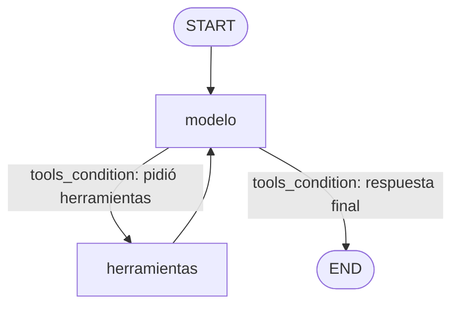

# Pre-entrega 5: agente de razonamiento cíclico con memoria persistente

Agente ReAct construido con **LangGraph** que responde consultas sobre clientes y pedidos de una tienda ficticia. Decide por sí mismo qué herramientas usar, reintenta cuando una herramienta falla o devuelve información incompleta, pide aclaraciones ante la ambigüedad y recuerda la conversación entre ejecuciones gracias a un checkpointer de SQLite.

## Arquitectura del grafo



- **`modelo`:** el LLM con las herramientas vinculadas mediante `bind_tools()`. Decide si responder o usar una herramienta.
- **`herramientas`:** un `ToolNode` que ejecuta las herramientas pedidas. Con `handle_tool_errors=True`, las excepciones se convierten en mensajes que el modelo puede leer.
- **Arista condicional:** `tools_condition` dirige el flujo según si el modelo pidió herramientas. No hay rutas manuales `if/else`.
- **Ciclo:** después de cada observación, el flujo vuelve al modelo, que razona de nuevo con el resultado.

## Estado

```python
class EstadoAgente(MessagesState):
    llamadas_herramientas: Annotated[int, operator.add]
```

- `messages` se hereda de `MessagesState`, cuyo reducer agrega los mensajes nuevos en lugar de reemplazar la lista.
- `llamadas_herramientas` usa el reducer `operator.add` para acumular cuántas herramientas se invocaron en la sesión.
- Antes de cada llamada al modelo, el historial se recorta con `trim_messages` a unos 4,000 tokens, para que el contexto no crezca sin límite. El historial completo se conserva en el checkpointer.

## Herramientas

Simulan consultas a una base de datos de clientes y pedidos (`tools.py`). Todas son asíncronas y usan `@tool` con docstrings detallados, porque el modelo decide qué herramienta usar a partir de esas descripciones.

| Herramienta | Entrada | Devuelve | Casos especiales |
|---|---|---|---|
| `buscar_cliente` | Nombre o parte del nombre | `cliente_id`, nombre y ciudad | Varias coincidencias: pide aclaración. Ninguna: sugiere nombres parecidos |
| `buscar_pedidos` | `cliente_id` | Cantidad, total y lista de pedidos | Lanza una excepción si el cliente no existe |
| `obtener_detalle_pedido` | `pedido_id` | Productos, estado y ciudad de envío | Devuelve un mensaje de error si el pedido no existe |

## Persistencia

Se usa `AsyncSqliteSaver`, la versión asíncrona de `SqliteSaver` de `langgraph-checkpoint-sqlite`. Cada conversación se identifica con un `thread_id`, y el estado se guarda en un archivo SQLite después de cada paso del grafo. La demostración cierra la conexión y abre una nueva a mitad de la sesión, para comprobar que la memoria sobrevive a un reinicio del programa.

## Proveedor del LLM

Se usa Gemini (`gemini-3.5-flash-lite`, plan gratuito) mediante `ChatGoogleGenerativeAI`, la integración oficial de LangChain para Gemini. Se eligió en lugar de `ChatOpenAI` con el endpoint compatible con OpenAI porque los modelos Gemini 3 exigen reenviar las *thought signatures* en cada ciclo de herramientas, y solo la integración nativa las conserva. Para usar OpenAI basta con cambiar `LLM_PROVIDER=openai`, `LLM_MODEL` y `OPENAI_API_KEY` en `.env`.

## Instalación

Desde la carpeta `pre-entrega-05`:

```bash
python -m venv .venv
source .venv/bin/activate
pip install -r requirements.txt
cp .env.example .env
```

Después, coloca tu clave en `GOOGLE_API_KEY` dentro de `.env`.

## Variables de entorno

| Variable | Descripción | Ejemplo |
|---|---|---|
| `LLM_PROVIDER` | Proveedor del modelo | `google` u `openai` |
| `LLM_MODEL` | Nombre del modelo | `gemini-3.5-flash-lite` |
| `LLM_TIMEOUT` | Segundos máximos por llamada | `60` |
| `GOOGLE_API_KEY` | Clave de Gemini, si el proveedor es `google` | |
| `OPENAI_API_KEY` | Clave de OpenAI, si el proveedor es `openai` | |

El archivo `.env` y las bases SQLite están excluidos del repositorio.

## Ejecución

```bash
python demo.py                          # prueba completa; genera traza_react.json y traza_react.log
python chat.py --thread mi-sesion       # chat interactivo con memoria persistente
```

Al cerrar `chat.py` y volver a abrirlo con el mismo `--thread`, el agente recuerda la conversación.

## Pruebas y traza ReAct

`demo.py` ejecuta cinco escenarios. La traza completa está en `traza_react.json` y `traza_react.log`.

| Sesión | Mensaje | Comportamiento observado |
|---|---|---|
| `sesion-mariana` | ¿Cuántos pedidos tuvo la clienta Mariana Lopes y cuál fue el total? | 3 herramientas: búsqueda fallida, reintento con el nombre sugerido y consulta de pedidos |
| `sesion-mariana` (tras reiniciar la conexión) | ¿Y el último? | Recordó la conversación y consultó el pedido P-1015 |
| `sesion-nueva` | ¿Y el último? | Sin contexto, no usó herramientas y pidió aclaración |
| `sesion-ana` | ¿Cuánto ha gastado Ana en total? | Encontró dos clientas y pidió aclaración; con "Ana Ruiz" respondió $12,000 |
| `sesion-error` | Resumen del cliente con id 999 | La herramienta lanzó un error; el agente lo explicó y ofreció buscar por nombre |

Extracto de la traza del razonamiento multi-paso:

```
[sesion-mariana] Usuario: ¿Cuántos pedidos tuvo la clienta Mariana Lopes y cuál fue el total?
  → El agente decide usar la herramienta: buscar_cliente({'nombre': 'Mariana Lopes'})
  → La herramienta buscar_cliente devuelve: {"resultado": "sin_coincidencias", "nombre_buscado": "Mariana Lopes", "sugerencias": ["Mariana López", "Ana Torres"]}
  → El agente decide usar la herramienta: buscar_cliente({'nombre': 'Mariana López'})
  → La herramienta buscar_cliente devuelve: {"resultado": "encontrado", "cliente": {"cliente_id": 102, "nombre": "Mariana López", "ciudad": "Monterrey"}}
  → El agente decide usar la herramienta: buscar_pedidos({'cliente_id': 102})
  → La herramienta buscar_pedidos devuelve: {"cliente_id": 102, "nombre": "Mariana López", "cantidad_pedidos": 3, "total_mxn": 14500, ...}
  → Respuesta: Mariana López tuvo un total de 3 pedidos, con un gasto acumulado de $14,500 MXN.

===== Conexión 2 a SQLite =====
[sesion-mariana] Usuario: ¿Y el último? ¿Qué productos incluía y en qué estado está?
  → El agente decide usar la herramienta: obtener_detalle_pedido({'pedido_id': 'P-1015'})
  → La herramienta obtener_detalle_pedido devuelve: {"pedido_id": "P-1015", ..., "estado": "enviado", "productos": ["Teclado mecánico", "Mouse ergonómico"], ...}
  → Respuesta: El último pedido de Mariana López (P-1015) se encuentra en estado enviado e incluía un teclado mecánico y un mouse ergonómico.
```

## Decisiones técnicas

- **`recursion_limit=10`** en cada invocación: si el agente entrara en un bucle, el turno se detiene de forma controlada.
- **Errores de herramientas como observaciones:** `ToolNode(handle_tool_errors=True)` permite que el modelo lea el error y decida si reintentar o pedir datos.
- **Docstrings como contrato:** en una primera ejecución, sin contexto, el agente inventó un nombre para buscarlo. Se corrigió precisando el docstring de `buscar_cliente` y el prompt del sistema, sin cambiar la lógica del grafo.
- **Búsqueda por palabras:** `buscar_cliente` compara el inicio de cada palabra, para que "Ana" no coincida con "Mariana".
- **Pausa entre turnos en la demo** para respetar el límite de peticiones por minuto del plan gratuito.

## Limitaciones conocidas

- La base de datos es simulada y vive en memoria.
- Las respuestas del modelo pueden variar ligeramente entre ejecuciones, aunque el comportamiento esperado se mantuvo en las pruebas.
- `trim_messages` descarta los mensajes más antiguos del contexto enviado al modelo; en conversaciones muy largas convendría resumirlos en lugar de recortarlos.

## Estructura

```
pre-entrega-05/
├── README.md
├── requirements.txt
├── .env.example
├── .gitignore
├── config.py
├── tools.py
├── agent.py
├── demo.py
├── chat.py
├── traza_react.json
└── traza_react.log
```