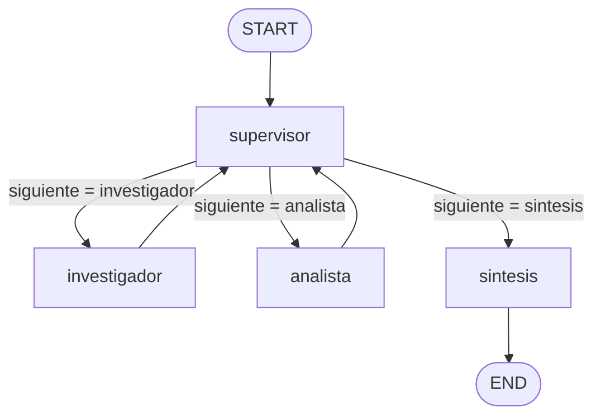

# Pre-entrega 6: orquestador multi-agente especializado

Prototipo de un orquestador de análisis e investigación construido con **LangGraph**. Un **supervisor** recibe la solicitud, delega en dos especialistas (un **investigador** que consulta la documentación en Pinecone y un **analista** que hace cálculos exactos), valida sus resultados con una rúbrica y, cuando la tarea está completa, pasa a una fase de **síntesis** que redacta la respuesta final.

## Diagrama del grafo



El archivo `grafo.mmd` contiene la versión generada automáticamente con `graph.get_graph().draw_mermaid()`.

## Topología elegida: jerárquica con supervisor

Se eligió una topología jerárquica porque la tarea es **semi-determinista**: primero hay que obtener datos, luego calcularlos y al final redactar. Esta topología aporta:

- **Control centralizado:** cada decisión pasa por el supervisor y queda registrada con su justificación, lo que facilita auditar el flujo.
- **Validación en un único punto:** el supervisor revisa los resultados antes de dar la respuesta final.
- **Especialistas aislados:** no se comunican entre sí; cada uno recibe solo lo que necesita.

Su principal riesgo, que el supervisor se convierta en un cuello de botella o entre en un bucle, se controla con los mecanismos descritos más abajo.

## Componentes

| Archivo | Responsabilidad |
|---|---|
| `state.py` | Estado compartido: tarea, siguiente nodo, contador de pasos y registros de contribuciones y decisiones |
| `agents/supervisor.py` | Decisión estructurada con rúbrica de validación y controles de parada |
| `agents/research_agent.py` | Investigador (`create_react_agent`) con la herramienta `buscar_documentacion` sobre Pinecone |
| `agents/analyst_agent.py` | Analista (`create_react_agent`) con `calcular`, `analizar_disponibilidad` y `comparar_con_umbral` |
| `agents/common.py` | Envoltura de los especialistas como nodos y aislamiento de contexto |
| `graph.py` | `StateGraph`, aristas condicionales y nodo de síntesis |
| `main.py` | Ejecuta la tarea de demostración y guarda la traza y el diagrama |
| `demo.ipynb` | Demostración del flujo de delegación, con sus salidas guardadas |

## Estado compartido

```python
class EstadoOrquestador(MessagesState):
    tarea: str
    siguiente: Literal["investigador", "analista", "sintesis"]
    instruccion: str
    pasos_supervisor: int
    contribuciones: Annotated[list[Contribucion], operator.add]
    decisiones: Annotated[list[Decision], operator.add]
    respuesta_final: str
```

Cada `Contribucion` registra el **paso, el agente, la instrucción recibida, el resultado y las herramientas usadas**. Cada `Decision` registra a quién delegó el supervisor, con qué instrucción y con qué evaluación. Ambas listas usan el reducer `operator.add`, así que se acumulan sin perder información. El detalle de una ejecución está en `traza_orquestador.json`.

## Supervisor y validación

El supervisor responde con salida estructurada en Pydantic (`DecisionSupervisor`): una evaluación, el siguiente nodo y una instrucción. La función de la arista condicional devuelve un `Literal` con los tres destinos posibles.

Antes de finalizar, aplica una **rúbrica de validación** incluida en su prompt:

1. **Datos documentados:** los umbrales y políticas provienen del investigador, con su fuente.
2. **Cálculos verificados:** cada cifra la produjo el analista con sus herramientas.
3. **Coherencia:** los cálculos usan exactamente los umbrales encontrados.
4. **Cobertura:** todas las partes de la tarea tienen respuesta.

Si un criterio no se cumple por completo, el supervisor devuelve el trabajo al especialista correspondiente con una instrucción de corrección.

## Manejo de conflictos y de los riesgos de la topología

| Riesgo | Mecanismo |
|---|---|
| Supervisor infinito | Tope de 6 decisiones (`MAX_PASOS_SUPERVISOR`); al alcanzarlo se fuerza la síntesis, indicando qué quedó pendiente |
| Finalizar sin evidencia | Validación determinista en código: no se permite la síntesis si falta el aporte de alguno de los especialistas |
| Bucles dentro de un especialista | `recursion_limit` de 8 pasos por especialista y de 25 en el grafo principal |
| Contaminación de contexto | El investigador solo recibe la instrucción del supervisor; el analista, la instrucción y únicamente los datos del investigador |
| Datos contradictorios entre agentes | Los especialistas no se comunican entre sí; el supervisor es el único que combina sus resultados y la rúbrica exige coherencia entre ellos |
| Cálculos aproximados por el modelo | El analista calcula con herramientas; `calcular` evalúa expresiones con `ast`, sin `eval()`, para no ejecutar código arbitrario |
| Hechos supuestos en la respuesta final | La síntesis solo puede usar datos de las contribuciones y debe presentar como condicionales las acciones que dependen de información desconocida |

## Demostración

Tarea de prueba, que requiere búsqueda documental, cálculo y síntesis:

> Este mes, de 30 días, Kestrel estuvo caído un total de 38 minutos. Además, durante un despliegue canario la tasa de errores llegó al 2,4 % durante 6 minutos consecutivos. ¿Cumplimos el objetivo de disponibilidad mensual, qué porcentaje del presupuesto de error consumimos y qué acciones exige la documentación por el episodio del despliegue?

Flujo observado: **supervisor → investigador → supervisor → analista → supervisor → síntesis**.

| Paso | Agente | Herramientas | Aporte |
|---|---|---|---|
| 1 | Investigador | `buscar_documentacion` | SLO de 99,9 %, presupuesto de unos 43 minutos, regla de reversión (más del 2 % durante 5 minutos) y regla de congelamiento, con sus fuentes |
| 2 | Analista | `analizar_disponibilidad`, `calcular`, `comparar_con_umbral` | Disponibilidad de 99,912 % (cumple), 87,96 % del presupuesto consumido y activación de la regla de reversión |
| 3 | Supervisor | | Validó los 4 criterios de la rúbrica y pasó a la síntesis |

La ejecución completa, con las evaluaciones del supervisor y la respuesta final, está en **`demo.ipynb`**, que se puede revisar directamente en GitHub sin ejecutarlo.

## Instalación y ejecución

Requiere el índice de Pinecone de la Pre-entrega 4 (`kestrel-hybrid-rag`, namespace `kestrel-docs`). Desde la carpeta `pre-entrega-06`:

```bash
python -m venv .venv
source .venv/bin/activate
pip install -r requirements.txt
cp .env.example .env        # coloca tus claves en .env
python main.py              # ejecuta la tarea y genera traza_orquestador.json y grafo.mmd
```

Para regenerar el notebook:

```bash
python crear_notebook.py
jupyter nbconvert --to notebook --execute demo.ipynb --inplace --ExecutePreprocessor.timeout=300
```

## Variables de entorno

| Variable | Descripción |
|---|---|
| `LLM_PROVIDER`, `LLM_MODEL` | Proveedor y modelo de los agentes (`google`, `gemini-3.5-flash-lite`) |
| `GOOGLE_API_KEY` | Clave de Gemini para los agentes |
| `OPENAI_API_KEY`, `OPENAI_BASE_URL`, `OPENAI_EMBEDDING_MODEL` | Embeddings con los que se indexó Pinecone en la Pre-entrega 4 |
| `PINECONE_API_KEY`, `INDEX_NAME`, `PINECONE_NAMESPACE` | Conexión al índice de documentación |

Los agentes usan `ChatGoogleGenerativeAI`, la integración nativa de Gemini, por la misma razón que en la Pre-entrega 5: conserva las *thought signatures* que Gemini 3 exige en los ciclos de herramientas. El archivo `.env` está excluido del repositorio.

## Limitaciones conocidas

- **Variabilidad entre ejecuciones:** el investigador no siempre recupera los mismos detalles. En una ejecución encontró también las acciones posteriores a una reversión; en otra, no.
- **El refinamiento no se activó en la demostración:** los resultados de cada especialista cumplieron la rúbrica en el primer intento, así que el supervisor no necesitó pedir correcciones. El mecanismo está implementado, pero esta prueba no lo ejercita.
- **La rúbrica la aplica un modelo:** en una ejecución anterior, el supervisor finalizó aunque él mismo había evaluado un criterio como "parcial". Se reforzó el prompt, y la validación en código cubre el caso más grave, que es finalizar sin el aporte de un especialista.
- **Límite de peticiones del plan gratuito:** cada consulta completa hace alrededor de 10 llamadas al modelo; con el límite de 15 por minuto no conviene lanzar varias consultas seguidas.

## Estructura

```
pre-entrega-06/
├── README.md
├── requirements.txt
├── .env.example
├── config.py
├── state.py
├── agents/
│   ├── __init__.py
│   ├── common.py
│   ├── research_agent.py
│   ├── analyst_agent.py
│   └── supervisor.py
├── graph.py
├── main.py
├── crear_notebook.py
├── demo.ipynb
├── grafo.mmd
└── traza_orquestador.json
```