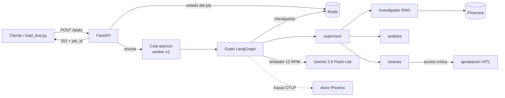

# Pre-entrega 7: API de producción y monitoreo activo

API asíncrona con FastAPI que expone el sistema multiagente de la pre-entrega 6 (supervisor, investigador RAG y analista sobre la documentación de Kestrel). Incluye estado de jobs y checkpoints en Redis, un nodo de aprobación humana (HITL), observabilidad con Arize Phoenix y una prueba de carga con 5 solicitudes concurrentes.

## Arquitectura



| Componente | Rol |
|---|---|
| FastAPI (`app/main.py`) | Endpoints asíncronos. `POST /tasks` responde `202` con un `job_id` en milisegundos y el trabajo sigue en segundo plano |
| Worker (`app/worker.py`) | Cola `asyncio.Queue` con 2 tareas en paralelo (`WORKER_CONCURRENCY`). Cualquier excepción deja el job en `FAILED` con el error |
| Redis | Tres usos: estado de cada job (hash `job:<id>`, TTL de 7 días), checkpoints de LangGraph (`AsyncRedisSaver`) y registro de auditoría de acciones aprobadas (`auditoria:acciones`) |
| Grafo (`app/graph.py`) | El sistema multiagente de la PE6 más un nodo `aprobacion` que se activa si la síntesis propone una acción crítica |
| HITL (`app/hitl.py`) | `interrupt()` pausa el grafo; el estado queda en Redis hasta que una persona aprueba o rechaza |
| Phoenix (`app/observability.py`) | Trazas de cada job y de cada llamada a LangChain/LangGraph, con tokens y latencia |

## Estructura

pre-entrega-07/
├── app/
│ ├── main.py # API y ciclo de vida (Redis, checkpointer, grafo, worker)
│ ├── worker.py # Cola y ejecución de jobs
│ ├── jobs.py # Repositorio de jobs en Redis
│ ├── graph.py # Grafo LangGraph con síntesis estructurada
│ ├── hitl.py # Nodo de aprobación y auditoría
│ ├── state.py # Estado del grafo y lectura robusta de registros
│ ├── config.py # Configuración, modelos y limitador de llamadas
│ ├── observability.py # Conexión con Phoenix
│ └── agents/ # Supervisor, investigador y analista (de la PE6)
├── docker-compose.yml # Redis 8 y Phoenix
├── load_test.py # Prueba de 5 solicitudes concurrentes
├── metricas_phoenix.py # p95 y costo por ejecución calculados desde las trazas
├── resultados_carga.json # Resultado de la prueba final
├── resultados_carga_v1_sin_limitador.json # Primera prueba (con el error 429)
├── metricas_phoenix.json # Métricas por job de la prueba final
├── requirements.txt
├── .env.example
└── screenshots/


## Endpoints

| Método y ruta | Qué hace | Respuestas |
|---|---|---|
| `GET /health` | Comprueba que la API está activa | `200` |
| `POST /tasks` | Crea un job. Cuerpo: `{"tarea": "...", "simular_error": false}` | `202` con `job_id` |
| `GET /tasks/{job_id}` | Estado y resultado del job | `200`, `404` si no existe |
| `POST /tasks/{job_id}/approve` | Aprueba o rechaza una acción crítica. Cuerpo: `{"aprobado": true, "comentario": "..."}` | `202`, `404`, `409` si el job no espera aprobación |
| `GET /tasks/{job_id}/checkpoint` | Último checkpoint de LangGraph guardado en Redis | `200`, `404` |

Con la API en marcha, la documentación interactiva está en `http://localhost:8000/docs`.

### Estados de un job

`PENDING` → `RUNNING` → `DONE`, o bien `RUNNING` → `AWAITING_APPROVAL` → (aprobación) → `PENDING` → `RUNNING` → `DONE`. Si ocurre cualquier error, el job pasa a `FAILED` y guarda el mensaje en el campo `error`.

### Cómo funciona el HITL

1. La síntesis devuelve una respuesta estructurada con `accion_critica` (`ninguna`, `revertir_despliegue` o `congelar_despliegues`) y su justificación.
2. Si la acción no es `ninguna`, el grafo pasa al nodo `aprobacion`, que llama a `interrupt()`. El checkpoint queda en Redis y el job pasa a `AWAITING_APPROVAL`, con la acción y su justificación en `aprobacion_pendiente`.
3. `POST /tasks/{job_id}/approve` reanuda el grafo con `Command(resume=...)`. Si se aprueba, la acción se ejecuta (de forma simulada) y se guarda un registro en `auditoria:acciones`. Si se rechaza, se registra como `RECHAZADA` y no se ejecuta nada.

## Requisitos previos

- Docker (en GitHub Codespaces lo instala `.devcontainer/devcontainer.json`).
- Python 3.12.
- Claves de Gemini y Pinecone. En Codespaces se guardan como secrets `GEMINI_API_KEY` y `PINECONE_API_KEY`, y `.env` solo contiene referencias a ellas.
- El índice de Pinecone `kestrel-hybrid-rag` (namespace `kestrel-docs`) con los documentos de Kestrel cargados en la pre-entrega 4.

## Cómo levantar el sistema

Todos los comandos se ejecutan desde la carpeta `pre-entrega-07`.

**1. Redis y Phoenix:**

```bash
docker compose up -d
docker compose ps
```

Ambos servicios deben aparecer como `running` (Redis como `healthy`). Phoenix queda en `http://localhost:6006`; en Codespaces se abre desde la pestaña **PORTS**.

**2. Entorno de Python:**

```bash
python -m venv .venv
source .venv/bin/activate
pip install -r requirements.txt
cp .env.example .env
```

Revisa `.env`. En Codespaces, las claves ya vienen de los secrets. Fuera de Codespaces, reemplaza los valores de ejemplo por tus claves y nunca subas `.env` al repositorio.

**3. API:**

```bash
uvicorn app.main:app --port 8000
```

Debe terminar con `Application startup complete`.

## Probar un job a mano

En otra terminal, con el entorno activado:

```bash
JOB=$(curl -s -X POST http://localhost:8000/tasks -H "Content-Type: application/json" \
  -d '{"tarea": "Durante un despliegue canario la tasa de errores llegó al 2,4 % durante 6 minutos consecutivos. ¿Qué exige la documentación?"}' \
  | python3 -c "import sys, json; print(json.load(sys.stdin)['job_id'])")
curl -s http://localhost:8000/tasks/$JOB              # repetir hasta ver AWAITING_APPROVAL
curl -s http://localhost:8000/tasks/$JOB/checkpoint
curl -s -X POST http://localhost:8000/tasks/$JOB/approve -H "Content-Type: application/json" \
  -d '{"aprobado": true, "comentario": "Aprobado tras revisar el umbral de reversión"}'
curl -s http://localhost:8000/tasks/$JOB              # debe terminar en DONE
docker compose exec redis redis-cli LRANGE auditoria:acciones 0 -1
```

Para comprobar el estado `FAILED`:

```bash
curl -s -X POST http://localhost:8000/tasks -H "Content-Type: application/json" \
  -d '{"tarea": "Prueba del manejo de errores del worker", "simular_error": true}'
```

## Reproducir la prueba de 5 solicitudes concurrentes

Con Redis, Phoenix y la API en marcha:

```bash
python load_test.py
python metricas_phoenix.py --minutos 120
```

- `load_test.py` envía las 5 tareas al mismo tiempo con `asyncio.gather`, consulta su estado cada 3 segundos, aprueba como revisor simulado los jobs que piden aprobación y guarda `resultados_carga.json`.
- `metricas_phoenix.py` descarga las trazas de Phoenix, mide solo los jobs de `resultados_carga.json` y calcula la latencia de procesamiento y el costo por ejecución. Guarda `metricas_phoenix.json`.

La prueba tarda entre 4 y 6 minutos por el límite del nivel gratuito de Gemini.

## Resultados de la prueba final

| Métrica | Valor | Fuente |
|---|---|---|
| Solicitudes concurrentes | 5 | `load_test.py` |
| Completadas | 5 de 5 (2 con aprobación HITL) | `load_test.py` |
| Respuesta de `POST /tasks` (p50 / p95) | 42,6 ms / 64,2 ms | `load_test.py` |
| Latencia de extremo a extremo (p50 / p95 / máx.) | 213,74 s / **327,38 s** / 355,04 s | `load_test.py` |
| Latencia de procesamiento (p50 / p95 / máx.) | 99,34 s / **199,16 s** / 212,26 s | Trazas de Phoenix |
| Llamadas al LLM | 43 (de 8 a 10 por job) | Trazas de Phoenix |
| Costo por ejecución (promedio / p95 / máx.) | **0,004981 USD** / 0,005898 USD / 0,005912 USD | Trazas de Phoenix |
| Costo total de la prueba | 0,024903 USD | Trazas de Phoenix |

**Cómo leer estas cifras:**

- **Los endpoints son asíncronos:** `POST /tasks` responde en milisegundos aunque cada job tarde minutos.
- **Hay dos latencias distintas.** La de extremo a extremo se mide desde el `POST` e incluye la espera en la cola del worker. La de procesamiento se mide en Phoenix desde que el worker toma el job. Por ejemplo, el job `f9c39970` tardó 355 s en total y 212 s en procesarse: esperó unos 143 s en cola.
- **Con 5 muestras, el p95 queda muy cerca del máximo.** Es una prueba de humo, no una medición estadística.
- **El costo es una estimación.** Se calcula con los tokens registrados en las trazas y los precios del nivel de pago de `gemini-3.5-flash-lite` (0,30 USD por millón de tokens de entrada y 2,50 USD por millón de salida). La prueba usó el nivel gratuito, así que el costo real fue 0.

### Evolución de la prueba

| Corrida | Configuración | Completadas | p95 de extremo a extremo |
|---|---|---|---|
| 1 | Sin limitador de llamadas | 4 de 5 (1 `FAILED` por `429`) | 109,93 s |
| 2 | Limitador de 12 llamadas por minuto | 5 de 5 | 201,83 s |
| 3 (final) | Limitador y observabilidad depurada | 5 de 5 | 327,38 s |

La corrida 1 está en `resultados_carga_v1_sin_limitador.json` y la final en `resultados_carga.json`. La corrida 2 no se guardó. La latencia varía entre corridas según cuántas llamadas al modelo hace el grafo en cada job y cuánto tarda Gemini en responder.

## Capturas

**Prueba de carga:**


**Latencia p95 y costo por ejecución calculados desde las trazas de Phoenix:**


**Trazas de los jobs en Phoenix:**


**Detalle de una traza (supervisor, especialistas, síntesis y aprobación):**


## Decisiones técnicas y problemas resueltos

| Problema | Causa | Solución |
|---|---|---|
| Tras aprobar, el job terminaba en `FAILED` con `KeyError: 'siguiente'`, aunque la acción sí se ejecutaba | Al reanudar, LangGraph lee el estado desde Redis y los objetos Pydantic vuelven en otro formato | `leer_campo()` en `app/state.py` lee el campo sea objeto, diccionario o diccionario serializado por LangChain |
| 1 de 5 jobs falló con `429 RESOURCE_EXHAUSTED` | 2 jobs en paralelo superaban el límite de 15 llamadas por minuto del nivel gratuito de Gemini; los reintentos llegaban tarde | `InMemoryRateLimiter` compartido por todos los modelos (12 por minuto, `LLM_RPM`). Se controla el ritmo antes de llamar en lugar de reaccionar al error |
| Phoenix mostraba un p95 de milisegundos | `register()` configuraba el proveedor de trazas como global y FastAPI registraba cada `GET /tasks/{job_id}` del sondeo (4 spans por consulta) | Instrumentación explícita: solo LangChain y los spans `job.*`, con `set_global_tracer_provider=False` |
| El panel de Phoenix mostró `Total Cost $0` | El costo de la interfaz depende de la tabla de precios del servidor | `metricas_phoenix.py` calcula el costo directamente desde los tokens de las trazas, con precios configurables (`PRECIO_ENTRADA_1M`, `PRECIO_SALIDA_1M`) |
| Phoenix respondía `401 Unauthorized` al recibir trazas | La imagen de Phoenix tenía la autenticación activada | `PHOENIX_ENABLE_AUTH: "false"` en `docker-compose.yml`, solo para desarrollo local. En producción se activaría la autenticación con una API key |

## Limitaciones

- **La acción crítica es simulada:** solo se registra en Redis, no se revierte ningún despliegue real.
- **La cola vive en memoria del proceso.** Si la API se reinicia, los jobs `PENDING` que aún no empezaron se pierden de la cola, aunque su estado y sus checkpoints siguen en Redis. En producción se usaría una cola persistente, como Redis Streams o Celery.
- **El nivel gratuito de Gemini (15 llamadas por minuto, 500 por día) limita el rendimiento.** Con un plan de pago bastaría con subir `LLM_RPM` y `WORKER_CONCURRENCY`.
- **El modelo no es determinista:** entre corridas puede proponer acciones críticas distintas para la misma tarea.

## Seguridad

- `.env` está en `.gitignore`. El repositorio solo incluye `.env.example`, con valores de ejemplo.
- Las claves viven como secrets de Codespaces y nunca aparecen en el código, los logs ni las capturas.
